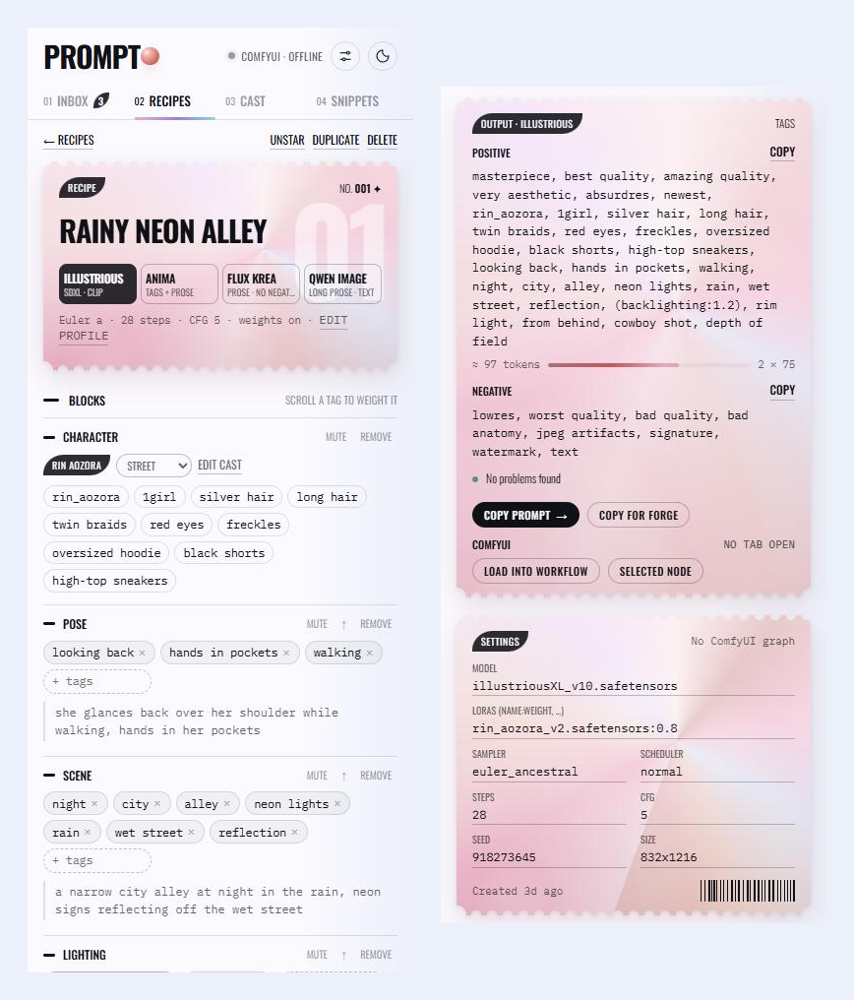
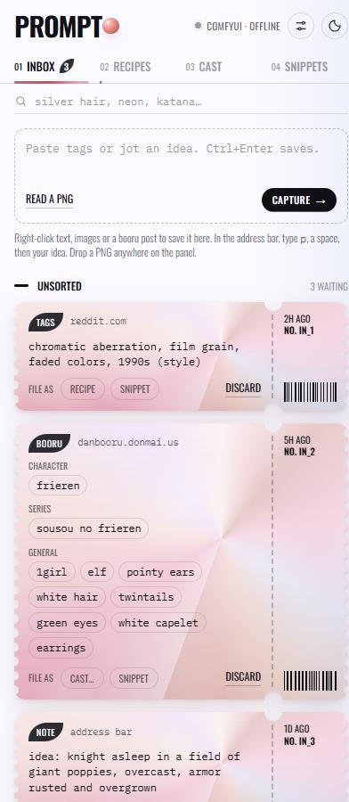
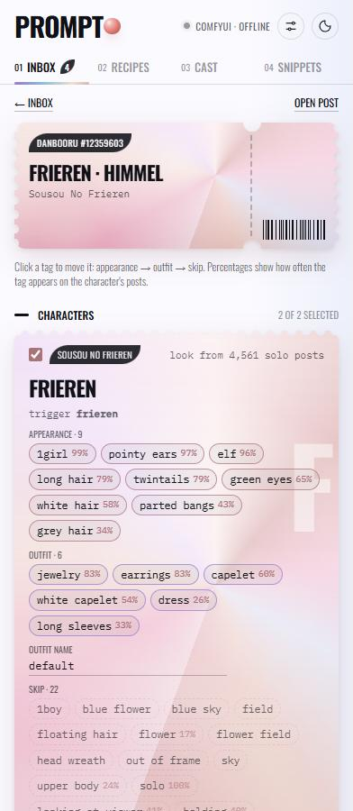
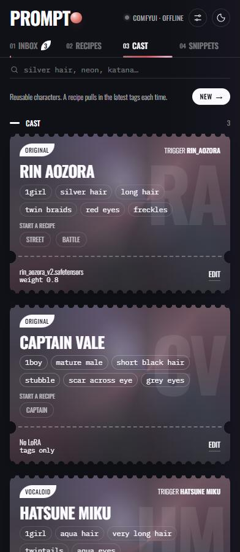
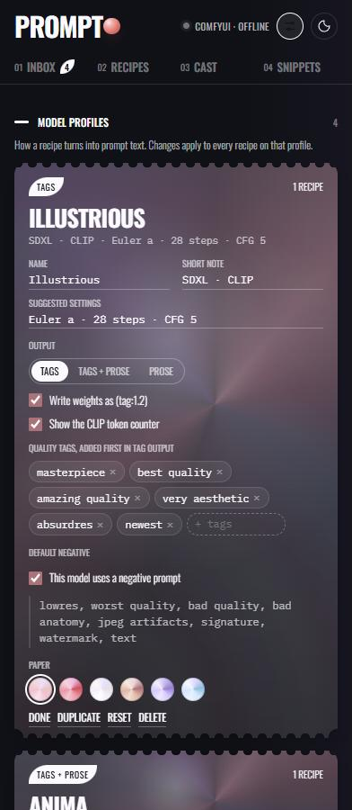

<h1 align="center">Prompto</h1>

<p align="center"><b>Catch prompts, tags and characters wherever you find them, and turn them into prompts for any model.</b></p>

<p align="center">
  <a href="https://github.com/EY4O/prompto/blob/main/LICENSE"></a>
  <a href="https://github.com/EY4O/prompto/commits/main"></a>
  <a href="https://ko-fi.com/looneth"></a>
</p>

A Chrome side-panel extension for people who make images with Stable Diffusion, Illustrious, Flux and Qwen. It's a home for the ideas you run into while browsing: tags from a Reddit thread, a character from Danbooru, the settings inside a PNG someone shared. Ideas land in an inbox, become reusable recipes, characters and snippets, and come out as the right prompt for whichever model you're using, as booru tags, natural language or both. It works without ComfyUI running, and connects to ComfyUI or Forge when you want it to. Open it from the toolbar icon or with **Alt+Shift+P**.



---

## ✨ Key Features

- 📥 **Inbox for everything** — right-click text, an image, a booru post or a Civitai image; type `p` and a space in the address bar; or drop a PNG on the panel.
- 🧬 **Recipes, results and versions** — reads the prompt and settings inside ComfyUI and A1111/Forge PNGs; images you make land back on their recipe with ★ ratings, and every run is versioned so you can compare what changed.
- 🧱 **One recipe, every model** — a recipe is made of blocks (subject, character, pose, scene, lighting…) with tags and prose side by side, and model profiles turn it into the right prompt for Illustrious, Anima, Flux Krea or Qwen Image.
- ✍️ **Prose from tags, no AI** — editable templates turn `1girl, silver hair, twin braids` into "a girl with long silver hair in twin braids" for prose models.
- 🎭 **Characters from boorus** — a **+ Prompto** button on Danbooru, Gelbooru and Safebooru posts (and right-click on e621) learns a character's usual look from their solo posts and sorts the tags into appearance and outfit.
- ⌨️ **Tag autocomplete** — suggestions from your own library, an imported Danbooru tag list (with post counts and aliases), and live Danbooru lookups.
- 🎚️ **Prompt tools** — scroll over a tag to weight it, `{a|b}` and `__snippet__` wildcards with a roll button, a CLIP token counter, and a checker for duplicates, contradictions and over-weighted tags.
- 🔗 **ComfyUI and Forge** — load a recipe, LoRAs included, straight into the open ComfyUI workflow, or copy it in Forge's format and fill in every setting with one click.
- 💾 **Yours to keep and share** — everything stays in your browser, with JSON backups and PNG share cards that carry a recipe or character to someone else's Prompto. No account, and no AI.

## 📸 Screenshots

| | |
|---|---|
|  **Inbox** — captures wait here until you file them as recipes, snippets or cast |  **Danbooru import** — each character's look, with how often each tag appears on their posts |
|  **Cast** — reusable characters with outfits, trigger words, LoRAs and reference images |  **Profiles** — decide how each model's prompt is written: tags or prose, quality tags, negatives |

<sub>Screenshots use sample data. The Danbooru post's artwork is hidden.</sub>

---

## 📦 Installation

Prompto isn't on the Chrome Web Store yet, so it's loaded as an unpacked extension.

### Option 1: **Clone and load unpacked** (Recommended)

```bash
git clone https://github.com/EY4O/prompto.git
```

1. Open `chrome://extensions` and turn on **Developer mode** (top right).
2. Click **Load unpacked** and pick the `prompto` folder.
3. Pin Prompto from the extensions menu so its icon stays in the toolbar.

To update later, `git pull` and press the reload arrow on Prompto's card in `chrome://extensions`.

### Option 2: **Download ZIP**

Download the repository as a ZIP from GitHub, unzip it somewhere permanent, then follow steps 1–3 above. Chrome loads the extension from that folder, so don't delete it.

<details>
<summary><b>ComfyUI companion (optional)</b></summary>

Install **[ComfyUI-Prompto](https://github.com/EY4O/ComfyUI-Prompto)** in ComfyUI's `custom_nodes` for a Prompto sidebar inside ComfyUI, right-click **Save to Prompto** on nodes and images, and optional auto-capture of saved images. Prompto works without it, but loading recipes into a workflow is more reliable with it installed.
</details>

## 🚀 Getting Started

1. Click the Prompto icon (or press **Alt+Shift+P**) to open the side panel. It starts with sample data you can remove later in **Settings → Library → Remove sample items**.
2. Capture something: right-click some tags on a page → **Save to Prompto**, or drop a ComfyUI PNG on the panel. It appears in the **Inbox**.
3. Press **File as → Recipe**. Pick a model profile at the top and adjust the blocks. The output card updates as you go.
4. Press **Copy prompt**, **Copy for Forge**, or, with ComfyUI open in a tab, **Load into workflow**.
5. On a Danbooru post, press **+ Prompto** next to a character tag, check the sorted tags, and press **File to cast**.
6. Optional: import a Danbooru tag list in **Settings → Tag autocomplete** for suggestions with post counts.

---

## 📖 How It Works

<details>
<summary><b>🧱 Blocks and model profiles</b></summary>

A recipe is a list of blocks: subject, character, outfit, pose, scene, lighting, camera and style. Each block holds tags (`twin braids, red eyes`) and an optional prose line ("a young woman with silver hair in twin braids"). A character block points at a cast member, so editing the character updates every recipe that uses them.

A **model profile** decides how the blocks become a prompt:

| Setting | What it does |
|---|---|
| Output | **Tags** (comma-separated), **Prose** (sentences), or **Tags + prose** |
| Weights | Writes `(tag:1.2)` when on; the checker warns when a profile ignores weights |
| Token counter | Shows an approximate CLIP token count and how many 75-token chunks it uses |
| Quality tags | Added first in tag output, e.g. `masterpiece, best quality` |
| Default negative | Used unless the recipe has its own; can be turned off (Flux Krea runs at CFG 1) |

The four starting profiles (Illustrious, Anima, Flux Krea, Qwen Image) are suggestions. Edit them, duplicate them, or add your own in **Settings → Model profiles**, and **Reset** restores a starting profile.
</details>

<details>
<summary><b>✍️ Prose from tags</b></summary>

When a block has no prose, prose and tags + prose profiles write one from its tags. Empty prose fields show the draft as a placeholder; **Write** fills it in so you can edit it. Turn this off per profile with **Draft prose from tags when a block has none**.

Drafts come from a template per block type, edited in **Settings → Prose templates**:

| Block | Default template | Example |
|---|---|---|
| Character | `[{name}, ]{who}[ with {appearance}]` | Rin, a girl with long silver hair in twin braids, red eyes and freckles |
| Outfit | `wearing {items}` | wearing an oversized hoodie, black shorts and high-top sneakers |
| Scene | `[{place}][ {time}][ with {details}]` | a city alley at night with neon lights and rain |
| Lighting | `lit by {list}` | lit by backlight and a rim light |

`{slots}` are filled from the tags; text in `[brackets]` is left out when a slot inside it is empty. Character drafts combine hair length, colour and style into one phrase, turn count and age tags into "a girl" or "a man", and leave out trigger words. `{name}` uses the cast member's name instead. Generic tags are dropped when a more specific one is present ("capelet" when "white capelet" is there).
</details>

<details>
<summary><b>🖼️ Reading PNGs</b></summary>

ComfyUI stores the queued graph in a PNG text chunk called `prompt`. A1111 and Forge store a `parameters` text block. Prompto reads either one:

- **ComfyUI**: it follows the sampler's positive and negative inputs back to the text nodes, including through ControlNet and Flux guidance nodes, and collects the model, LoRAs, sampler, scheduler, steps, CFG, seed and size. The graph is kept, so **Queue saved graph** can run it again with your edited prompt.
- **A1111/Forge**: it splits out the negative prompt and settings line, and pulls `<lora:…>` tags out of the prompt.

Images without generation data are kept as reference images.

**Civitai** usually strips the data from its image files, so right-click a Civitai image (or its thumbnail link) → **Import Civitai image recipe** reads it from Civitai's public images API instead. That covers the prompt, negative, model, LoRAs (from the resource list and `<lora:…>` tags), sampler and scheduler (mapped from names like "DPM++ 2M Karras"), steps, CFG, seed and size. Images generated on Civitai with ComfyUI also bring their graph.
</details>

<details>
<summary><b>⭐ Results and ratings</b></summary>

Each recipe keeps a gallery of the images made from it, up to 60:

- **From ComfyUI**: with ComfyUI-Prompto installed, captured images whose prompt matches a recipe go straight to that recipe's **Results** instead of the inbox. Turn this off in **Settings → ComfyUI**.
- **From a PNG**: drop it on the panel. If its prompt matches a recipe, the inbox shows **Same prompt as …** and a **Results** button.
- **Matching**: Prompto remembers what you copied, loaded or queued in the last three days, then compares against every recipe's current prompt. Case, spacing, escaped brackets and trailing commas don't matter.

Click a result to open it larger, rate it, make it the recipe's cover, or copy its seed back into the recipe. Recipe cards show the average rating, and **Recipes** can be sorted by **Top rated** or **Most results**.
</details>

<details>
<summary><b>🕘 Versions</b></summary>

A version is saved each time a recipe leaves Prompto (**Copy prompt**, **Copy for Forge**, **Load into workflow**, **Selected node**, **Queue saved graph**) and when you press **Save version**, as long as something changed. Each recipe keeps its last 30.

**Compare** shows what changed between that version and now: tag by tag for tag prompts, word by word for prose, plus any changed settings. **Restore** brings a version back, after first saving the current state as **before restore**.
</details>

<details>
<summary><b>🎟️ Share cards</b></summary>

**Share card** on a recipe, or **Share** on a cast member, saves a PNG drawn as a Prompto ticket. The picture shows the title, cover, prompt and settings; the file also carries the data:

| Text chunk | Read by | Holds |
|---|---|---|
| `prompto` | Prompto | the recipe with its cast members and model profile, or the cast member |
| `parameters` | Forge, A1111 and anything that reads their format | the prompt, negative and settings, with wildcards rolled |
| `prompt` | ComfyUI | the recipe's ComfyUI graph with the current prompt, when it has one |

Drop a card on Prompto and it appears in the inbox as a **Prompto card**; **Import** adds it. Characters on a card are matched to your cast by trigger word (or name), so a shared recipe uses your existing Rin instead of a duplicate; new outfits and tags are merged in. Cards leave out results, versions and reference images. A cover image from another site can only be drawn if that site allows it; otherwise the card has no cover.
</details>

<details>
<summary><b>🎭 Danbooru character import</b></summary>

- Posts are read through Danbooru's JSON API (`/posts/{id}.json`), so tags arrive already split into character, series, artist and general.
- A character's look comes from Danbooru's related tags for that character on **solo, general-rated** posts. Tags found on at least 40% of those posts are suggested; tags at 25–40% are shown under **Skip** so you can promote them. Characters with fewer than 25 solo posts use all their posts instead.
- When a post has several characters, each of the post's tags goes to whichever character Danbooru links it to most strongly, so one character doesn't get another's hair colour.
- Tags are sorted by simple word rules (hair, eyes, ears → appearance; dress, gloves, earrings → outfit; scene and framing → skip). Click any tag to move it.
- If the character is already in your cast, you can add the post's clothes as a new outfit instead of making a duplicate.
- Looks are cached for a week.

| Site | How the post is read | Character look |
|---|---|---|
| Danbooru | JSON API | Danbooru related tags |
| Gelbooru, Safebooru | the tag list on the page (their APIs need accounts or don't give tag types) | Danbooru, by tag name; most names match, and Danbooru resolves common alternate spellings |
| e621, e926 | JSON API, right-click only | this post only (e621 doesn't offer related tags without an account); species tags count as appearance |
</details>

<details>
<summary><b>🖼️ Reference boards</b></summary>

Each cast member has a strip of reference images, and each outfit has its own. To add one:

- **Drop** image files onto a cast card, or onto an outfit's strip in **Edit** mode.
- **Drag** an image straight out of another web page onto a card; its address is saved.
- In the inbox, file an image with **Reference…** and pick the character or outfit.
- Danbooru imports add the post's image automatically.

Click a reference to open it, add a note or source, make it the card's cover, or remove it. Dropped files are stored as 640px copies; images dragged from web pages are kept as links, so they disappear if the site removes them.
</details>

<details>
<summary><b>🎲 Wildcards and variations</b></summary>

Use these anywhere in tags or prose:

| Syntax | Becomes |
|---|---|
| `{red\|blue\|silver} eyes` | one of the options; options can nest, and an empty one means "nothing" |
| `__hair_color__` | one tag from the snippet named **Hair color**, or one snippet from the category **Hair color** |

The output card shows one roll of the prompt. **Roll again** and **← Back** step through rolls, which are repeatable: roll 3 is always the same roll 3 for that recipe. Copying, **Load into workflow** and **Copy for Forge** use the roll you see; **Copy with wildcards** keeps the syntax for tools like Dynamic Prompts. Names that don't match a snippet are flagged by the checker. Inside `{…}`, separate options with `|`, not commas.

**Queue variants** loads and queues 2–6 rolls in the open ComfyUI tab, one after another, all on the recipe's seed, so you can compare them side by side. Each roll is remembered, so the images come back to the recipe's **Results**.
</details>

<details>
<summary><b>🧩 LoRAs</b></summary>

- Each recipe lists its LoRAs in **Settings** with a weight slider. Add one from the **+ LoRA** field, or type `<` in any tag field to search LoRAs; picking one adds it to the recipe instead of the tags. `<lora:name:0.8>` typed or pasted into a tag field works the same way.
- Prompto reads ComfyUI's installed LoRAs (every 10 minutes while ComfyUI is reachable, or **Settings → ComfyUI → Refresh**). Suggestions show each LoRA's folder, and LoRAs that aren't installed get a ⚠ and a warning in the checker.
- **Copy for Forge** writes LoRAs as `<lora:name:weight>` in the prompt.
</details>

<details>
<summary><b>⌨️ Tag autocomplete</b></summary>

Every **+ tags** field suggests tags from three places, in this order:

1. **Your tags**: anything already used in your recipes, cast, snippets and profiles.
2. **An imported tag list**: a CSV in the [a1111 tag-autocomplete](https://github.com/DominikDoom/a1111-sd-webui-tagcomplete) format (`name,category,post count,"aliases"`). It's kept in IndexedDB on your device and matches tag starts, word starts and aliases.
3. **Danbooru**: when the list has fewer than five matches, Prompto asks Danbooru's tag API. You can turn this off in **Settings**.

Underscores become spaces, except in emoticons such as `^_^`.
</details>

<details>
<summary><b>🔗 Connecting to ComfyUI</b></summary>

- Prompto checks the ComfyUI address in **Settings** every few seconds (default `http://127.0.0.1:8188`). The header shows **offline**, **live**, **tab open** or **linked**.
- **Load into workflow** and **Selected node** edit the workflow in your open ComfyUI tab. Settings go to the first sampler, so a hires-fix pass keeps its own steps, and dropdown values are only set when ComfyUI offers them.
- **LoRAs** fill the workflow's existing LoRA loader nodes in order, matched by file name even across folders, with the recipe's weight on both model and CLIP. Loaders the recipe doesn't use, or whose LoRA isn't installed, are bypassed, and Prompto says when the workflow needs more loader nodes. It never adds nodes itself.
- With **ComfyUI-Prompto** installed, Prompto works through its bridge instead of ComfyUI's internals, syncs your library to the ComfyUI sidebar, and collects captures from ComfyUI.
- Recent ComfyUI versions turn away requests that come straight from extensions. That's why Prompto goes through the open tab. **Queue saved graph** calls the API directly and may need ComfyUI started with `--enable-cors-header`.
- The ComfyUI desktop app isn't a browser tab, so only **Queue saved graph** works with it.
</details>

<details>
<summary><b>💾 Data and permissions</b></summary>

- Your library lives in `chrome.storage.local`; the imported tag list lives in IndexedDB. Use **Settings → Library → Export** for a backup. The tag list isn't included.
- Network requests go only to Danbooru (posts, related tags and optional tag lookups), Civitai's images API (when you import from Civitai), your ComfyUI address, and Google Fonts for the panel's typefaces.
- Permissions: **side panel**, **storage** and **unlimited storage** for the library and images; **context menus** for right-click capture; **scripting** and **active tab** to read booru pages and reach the ComfyUI tab; access to `localhost`/`127.0.0.1` (ComfyUI), `*.donmai.us`, `gelbooru.com`, `safebooru.org`, `e621.net`/`e926.net` (boorus) and `civitai.com` (Civitai). Other ComfyUI addresses are requested when you save them.
- Prompto never queues anything on its own. Deleting a recipe, profile or tag list takes a second press to confirm.
</details>

---

## 🧪 Development

Running from source, project layout and releasing are described in **[docs/DEVELOPMENT.md](docs/DEVELOPMENT.md)**.

## 🗺️ Roadmap

- An icon and a Chrome Web Store listing.
- Bundle the fonts so the panel looks right offline.

## 🤝 Contributing

Issues and pull requests are welcome. Please describe how you tested a change, since there's no automated test suite yet.

## 🙏 Credits

- [Danbooru](https://danbooru.donmai.us/wiki_pages/help:api): the post, related-tag and tag APIs behind character import and autocomplete
- [a1111-sd-webui-tagcomplete](https://github.com/DominikDoom/a1111-sd-webui-tagcomplete): the tag-list CSV format
- [ComfyUI](https://github.com/comfyanonymous/ComfyUI): workflow metadata and the API Prompto talks to
- [Oswald](https://fonts.google.com/specimen/Oswald) and [IBM Plex Mono](https://fonts.google.com/specimen/IBM+Plex+Mono): typefaces
- The holographic ticket look is adapted from an [Instalanding](https://instalanding.ai/demos/murmur-swarm-tickets.html) demo (MIT)

## ☕ Support

If Prompto keeps your favourite prompts and characters one click away, you can support its development:

[](https://ko-fi.com/looneth)

## 📄 License

[MIT](LICENSE)
